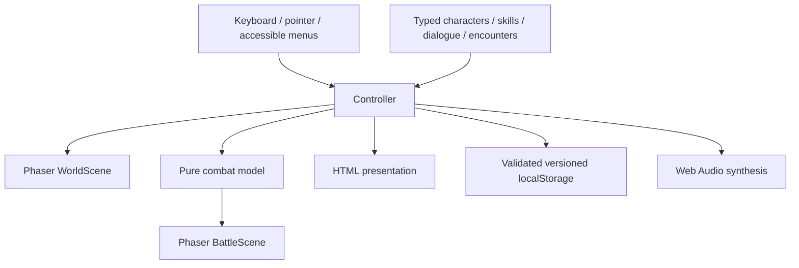

# Technical design

`src/game/controller.ts` owns the session, menu/dialogue state and transitions. Phaser scenes receive explicit data and callbacks; combat data is copied into a battle and committed to the world only after victory. A failed or interrupted battle reloads the saved pre-battle world.

`src/game/combat.ts` has no browser dependency. It validates commands, resources, sides, and living targets before mutation. Speed determines initiative each round. Dead actors are removed immediately. Victory and defeat are terminal. Guard lasts until the owner acts again. Status durations count owner actions; taunt does not redirect area attacks.

`src/game/save.ts` validates the version, area, coordinates, party identity, resource values, status types and flags. Save errors are visible in the UI. No credentials or personal information are stored.

`src/scenes/art.ts` produces stable texture names and sizes. World decoration uses per-area seeded RNG. Collision rectangles are fixed independently from animation and illustration.

Rendering: Phaser AUTO (WebGL then Canvas). A query parameter selects Canvas explicitly for reproducible browser automation. The world is 1600 × 960 logical pixels; viewport is 1280 × 720 with camera following and responsive HTML overlays.
